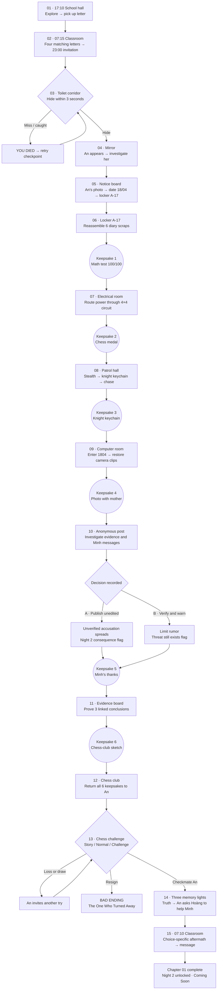

# AN — Tiếng Gậy Trong Đêm: Chapter 01 Game Flow

## Design intent

Build the supplied story as an exploration-first 2D top-down cinematic horror adventure. Keep all 15 canonical scenes and six keepsakes in order. Dialogue and memories are short, playable spaces carry the pacing, and every non-ending branch rejoins the main route. This is the implementation flow, not a replacement script.

## Main flow

## Scene contracts

| Scene | Player-facing goal / interaction | Gate and persistent result |
|---|---|---|
| 01 — Lá thư bí ẩn | Walk to the envelope, press E, read it; hear the upstairs knock | Letter read; intro checkpoint |
| 02 — Cứu tôi | Read classroom plea and matching letters; accept 23:00 meeting | Night 1 begins |
| 03 — Ba giây | Reach and enter a toilet stall during a real 3-second timer | Retry checkpoint on failure; survive flag on success |
| 04 — Chiếc gương | Witness reflection and follow An's gesture to the board | “Find the mysterious girl” objective |
| 05 — Bảng tin | Inspect defaced photo and reverse | An identity, 18/04, A-17 clue |
| 06 — Nhật ký bị xé | Collect six paper pieces and place them in diary order | Memory 1, mother recollection |
| 07 — Phòng điện | Rotate 16 circuit tiles to connect supply to stair lock | Stair door and display unlocked; Memory 2 |
| 08 — Hành lang truy đuổi | Read patrol cones, crouch/hide, distract; take An's hint; escape chase | Memory 3 and computer-room destination |
| 09 — Máy tính duy nhất | Enter 1804; order corrupted camera clips; inspect accident report | Memory 4 and evidence retained |
| 10 — Bài đăng bí ẩn | Compare drafts, timestamps, account clues; inspect An–Minh conversation | Memory 5; persist publish-raw vs verify-and-warn choice |
| 11 — Bảng suy luận | Connect evidence into three required conclusions | Memory 6 and club-room objective |
| 12 — Phòng cờ vua | Place each collected keepsake into its matching slot | Six memories returned; chess unlocked |
| 13 — Ván cờ cuối cùng | Pick a mode and play legal chess | Loss/draw retry; resign bad ending; checkmate unlocks final memories |
| 14 — Ký ức cuối cùng | Visit three memory lights and receive black king | Truth acknowledged; black king inventory item |
| 15 — Người tiếp theo | Wake at school and see branch-specific Minh aftermath | Chapter 01 complete; Night 2 unlocked, no Night 2 story content |

## State model and checkpoints

- `chapter`: `night_1` until scene 15; then `night_1_complete` and `night_2_unlocked`.
- `scene_id` and `checkpoint_id`: resume scene-level progress without replaying completed sequences.
- `inventory.keepsakes`: six stable IDs (`math_test`, `chess_medal`, `knight_keychain`, `mother_photo`, `minh_thanks`, `chess_club_sketch`); never duplicate.
- `evidence`: diary, camera/report, historical post, Minh draft/message, board conclusions.
- `decision.minh_post`: `unresolved`, `publish_raw`, or `verify_warn`; choice is immutable after scene 10 confirmation.
- `ending`: `none`, `bad_turn_away`, or `good_remembered`; a loss/draw is not an ending.
- Checkpoint after each scene gate and before the 3-second event / chess mode. Save under Godot `user://`; missing or invalid data should load the latest safe checkpoint/default state rather than strand the player.

## Feedback, pacing, and fairness

- The three-second event must start on a clear audio/visual cue, allow movement immediately, identify the stall as a valid hiding spot, and keep retry one action away.
- Stealth uses readable enemy vision and suspicion states; hiding and distraction must break pursuit. Chase obstacles are telegraphed, with a retryable checkpoint.
- Evidence-board and diary puzzles confirm what has been placed and give non-spoiling hints after repeated idle time; they do not require pixel-precise mouse input.
- Preserve uncertainty around An's final accident: the camera establishes a chase and missing evidence, not an invented culprit or definitive account beyond the supplied story.
- Choice B limits the rumor; it does not magically remove the threat. Both branches still ask the player to help Minh.
- Chess uses actual legal moves and permits unlimited retry on loss/draw. Resign is a separate explicit action before ending.

## First vertical slice

The first implementation milestone covers scenes 01–04: letter interaction and reading, the next-morning story transition, the timed hiding event with retry, and the mirror/An objective. Later puzzles remain TODO until this slice imports, launches and is reviewed.
